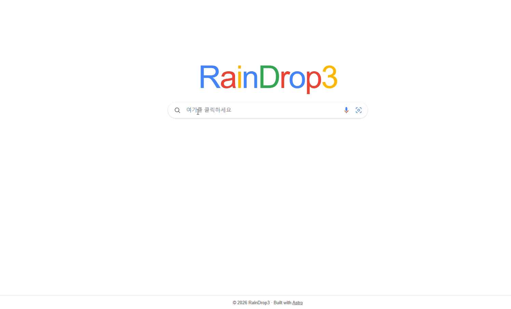

# portfolio

검색창 화면 형태로 만든 개인 포트폴리오 사이트입니다.

- 사이트: https://raindrop3.github.io/portfolio/



## 실행

```bash
npm install
npm run dev      # 개발 서버
npm run build    # dist/ 로 빌드
```

## 구조

| 경로 | 내용 |
|---|---|
| `src/pages/index.astro` | 메인 (로고, 검색창) |
| `src/pages/about.astro` | 소개 (학력, 수상, 활동) |
| `src/pages/projects.astro` | 프로젝트 |
| `src/data/links.ts` | 이름, 링크, 검색 제안 목록 |
| `public/resume.pdf` | 이력서 (마스킹 버전) |
